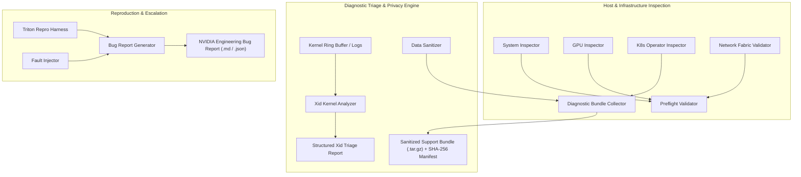

<div align="center">

# NVIDIA AI Enterprise (NVAIE) Supportability Toolkit

**Production-grade diagnostic automation, preflight validation, Xid error triage, and reproducible test harnesses for enterprise AI platforms on Kubernetes & Hybrid Cloud.**

[](https://python.org)
[](https://kubernetes.io)
[](https://developer.nvidia.com/cuda-zone)
[](https://github.com/triton-inference-server/server)
[-34D399?style=flat-square&logo=pytest)](https://pytest.org)
[](https://opensource.org/licenses/Apache-2.0)

</div>

---

## Overview

Deploying and sustaining **NVIDIA AI Enterprise (NVAIE)** in production environments (AWS EKS, Azure AKS, GCP GKE, and on-premise DGX SuperPODs) presents complex, multi-layered failure modes spanning Linux kernels, PCIe topologies, GPU drivers, Kubernetes Operator DaemonSets, RDMA network fabrics, and inference serving backends.

The **NVAIE Supportability Toolkit** (`nvaie-toolkit`) is an enterprise-grade systems diagnostic and sustaining engineering suite designed to:
1. **Prevent Deployment Regressions:** Validate host OS parameters, cgroups v2, IOMMU / VT-d, driver matrix certifications, and Container Toolkit configuration before GPU workload rollout.
2. **Audit GPU Operator Health:** Verify Kubernetes GPU Operator DaemonSets (`nvidia-driver`, `nvidia-container-toolkit`, `nvidia-device-plugin`, `nvidia-dcgm-exporter`), node resource allocations, and pod scheduling failures.
3. **Automate Live-Site Xid Triage:** Ingest Linux kernel ring buffers (`dmesg`) to parse, classify, and attribute NVIDIA driver Xid errors (e.g. Xid 31 MMU fault, Xid 43 engine timeout, Xid 79 GPU fallen off bus, Xid 92 uncorrectable ECC) directly to root causes and immediate mitigations.
4. **Sanitize & Package Diagnostics:** Assemble complete diagnostic tarballs with SHA-256 integrity verification while stripping corporate IPs, credentials, JWTs, and NGC API keys.
5. **Reproduce Customer Sev1 Outages:** Benchmark Triton Inference Server endpoints, profile P50/P90/P99 latency, and simulate dynamic batching memory exhaustion (CUDA OOM) and worker thread pool starvation.
6. **Generate Standardized Bug Reports & RFEs:** Format escalation telemetry and environment matrices into executive Markdown/JSON artifacts for NVIDIA Sustaining Engineering.

---

## Architecture



---

## Key Modules

| Module | Location | Description |
|:---|:---|:---|
| **System Inspector** | [`nvaie_toolkit/core/system_inspector.py`](nvaie_toolkit/core/system_inspector.py) | Low-level OS, cgroups v1/v2, IOMMU/VT-d, HugePages, NUMA topology, and PCIe scanning. |
| **GPU Inspector** | [`nvaie_toolkit/core/gpu_inspector.py`](nvaie_toolkit/core/gpu_inspector.py) | Parses `nvidia-smi -q -x` XML for VRAM utilization, power/thermal throttling, PCIe link downgrades, and double-bit uncorrectable ECC errors. |
| **K8s Operator Inspector** | [`nvaie_toolkit/core/k8s_inspector.py`](nvaie_toolkit/core/k8s_inspector.py) | Audits GPU Operator DaemonSets, failed container states (`CrashLoopBackOff`, `ImagePullBackOff`), and node `nvidia.com/gpu` allocatables. |
| **Preflight Validator** | [`nvaie_toolkit/validators/preflight.py`](nvaie_toolkit/validators/preflight.py) | Comprehensive readiness checks against certified NVAIE production driver branches (535, 550, 560, 570). |
| **Network Fabric Validator** | [`nvaie_toolkit/validators/network_fabric.py`](nvaie_toolkit/validators/network_fabric.py) | Audits GPUDirect RDMA prerequisites, `nvidia-peermem` kernel module, InfiniBand/RoCE interfaces, and MTU 9000 jumbo frames. |
| **Xid Error Analyzer** | [`nvaie_toolkit/collectors/xid_analyzer.py`](nvaie_toolkit/collectors/xid_analyzer.py) | Parses kernel logs for Xid errors; correlates with official NVIDIA knowledge base for immediate operational triage. |
| **Data Sanitizer** | [`nvaie_toolkit/collectors/sanitizer.py`](nvaie_toolkit/collectors/sanitizer.py) | Enterprise privacy engine masking IPv4 addresses, NGC API keys (`nvapi-*`), JWT tokens, passwords, and custom enterprise keywords. |
| **Bundle Collector** | [`nvaie_toolkit/collectors/log_bundle.py`](nvaie_toolkit/collectors/log_bundle.py) | Packages sanitized telemetry, dmesg, and K8s states into `.tar.gz` with SHA-256 verification manifest. |
| **Triton Repro Harness** | [`nvaie_toolkit/repro_harness/triton_bench.py`](nvaie_toolkit/repro_harness/triton_bench.py) | Multi-threaded client testing Triton HTTP/gRPC endpoints, measuring P50/P90/P99 latency and throughput. |
| **Fault Injector** | [`nvaie_toolkit/repro_harness/fault_injector.py`](nvaie_toolkit/repro_harness/fault_injector.py) | Simulates dynamic batching VRAM exhaustion (CUDA OOM) and Triton thread pool queue starvation. |
| **Bug Report Generator** | [`nvaie_toolkit/reporter/bug_report_generator.py`](nvaie_toolkit/reporter/bug_report_generator.py) | Synthesizes escalation context into formal NVIDIA Engineering Bug Reports. |

---

## Quickstart & CLI Reference

### 1. Installation
```bash
git clone https://github.com/uday68/nvaie-supportability-toolkit.git
cd nvaie-supportability-toolkit
pip install -e .
```

### 2. Preflight Installation Readiness Check
Validates kernel parameters, cgroups, IOMMU, HugePages, and certified driver branches:
```bash
nvaie-toolkit check-preflight
```
*Output:*
```text
[*] NVAIE Preflight Readiness Status: [PASS]
    Passed: 6 | Warnings: 1 | Failures: 0

RULE ID         CATEGORY           STATUS   TITLE
---------------------------------------------------------------------------
NVAIE-SYS-001   System             [PASS] CPU Architecture Compatibility
NVAIE-SYS-002   Kernel             [PASS] Control Groups (cgroups) Version
NVAIE-SYS-003   Virtualization     [PASS] IOMMU / VT-d Hardware Virtualization
NVAIE-SYS-004   Memory             [PASS] HugePages Allocation
NVAIE-CTK-001   Container Runtime  [PASS] NVIDIA Container Toolkit Presence
NVAIE-DRV-001   NVIDIA Driver      [PASS] Certified Production Driver Branch
NVAIE-ECC-001   GPU Health         [PASS] Uncorrectable ECC Double-Bit Errors
```

### 3. GPU Operator Audit on Kubernetes
Audits DaemonSet reconciliation states across worker nodes:
```bash
nvaie-toolkit check-operator --namespace gpu-operator
```

### 4. Kernel Xid Error Triage
Parses kernel ring buffer (`dmesg`) for hardware, driver, and compute engine faults:
```bash
nvaie-toolkit triage-xid --log-file /var/log/dmesg
```
*Output:*
```text
[*] NVIDIA Kernel Xid Error Triage
    Total Xid Events: 1
    Sev1 Critical:    0
    Sev2 High:        1
    Requires Drain:   False

[Xid 31] (0000:1b:00) [SEV2_HIGH] GPU Memory Page Fault (MMU Fault)
  Raw: NVRM: Xid (PCI:0000:1b:00): 31, pid=4812, name=tritonserver, Page Fault on VA 0x7fa281000000
  Root Cause: GPU Memory Management Unit (MMU) fault. A CUDA kernel attempted an illegal out-of-bounds read/write.
  Mitigation: Inspect CUDA / PyTorch application for illegal memory access or indexing bugs; run with compute-sanitizer.
  Action:     Run customer application under 'compute-sanitizer --tool memcheck'.
```

### 5. Generate Sanitized Support Bundle
Packages system state, GPU XML dumps, preflight results, and kernel logs:
```bash
nvaie-toolkit collect-bundle --output ./diagnostics --sanitize-keyword "CustomerBankCorp"
```
*Output:*
```text
[+] Diagnostic bundle generated successfully:
    Archive:  diagnostics/nvaie-support-bundle-20261101-213000.tar.gz
    Size:     14,820 bytes
    SHA-256:  a1c94e82b7f948c2...
    Files Included:
      - system_telemetry.json
      - gpu_status.json
      - preflight_audit.json
      - network_fabric.json
      - dmesg.log
      - xid_triage.json
      - k8s_operator_status.json
```

### 6. Triton Repro Harness & Benchmark
Exercises Triton model inference under concurrent stress:
```bash
nvaie-toolkit repro-triton --url http://localhost:8000 --model transformer_encoder --requests 100 --concurrency 8
```

### 7. Generate NVIDIA Engineering Bug Report
Generates an audited Sev1/Sev2 escalation report with full environment matrix:
```bash
nvaie-toolkit report-sample --format md --output ./Sev1-Incident-Report.md
```

---

## Kubernetes Helm Deployment

A production-grade Helm chart for deploying Triton Inference Server with NVIDIA AI Enterprise readiness probes, GPU limits, and Prometheus ServiceMonitor is included in [`helm/triton-nvaie-benchmark/`](helm/triton-nvaie-benchmark/):

```bash
helm upgrade --install triton-nvaie ./helm/triton-nvaie-benchmark \
  --namespace ai-inference --create-namespace \
  --set resources.limits."nvidia\.com/gpu"=1 \
  --set replicaCount=2
```

---

## Sev1 Outage Runbook

Refer to [`docs/RUNBOOK_SEV1_TRIAGE.md`](docs/RUNBOOK_SEV1_TRIAGE.md) for the complete 15-minute operational runbook covering:
* Immediate War Room triage protocols.
* Xid error matrix and node drain decisions.
* Dynamic batching VRAM exhaustion mitigations.
* Triton worker thread pool starvation recovery.

---

## Verification & Test Suite

The test suite validates all inspectors, sanitizers, Xid classification rules, preflight checks, and repro harnesses:

```bash
pytest tests/ -v
```
```text
============================= test session starts =============================
collected 11 items

tests/test_collectors.py::test_sanitizer_masks_confidential_patterns PASSED [  9%]
tests/test_collectors.py::test_sanitizer_dict_recursive PASSED           [ 18%]
tests/test_collectors.py::test_diagnostic_bundle_creates_valid_tar_and_manifest PASSED [ 27%]
tests/test_repro_harness.py::test_triton_bench_simulation PASSED         [ 36%]
tests/test_repro_harness.py::test_fault_injector_cuda_oom PASSED         [ 45%]
tests/test_repro_harness.py::test_fault_injector_threadpool_starvation PASSED [ 54%]
tests/test_validators.py::test_preflight_validator_passes_on_compliant_system PASSED [ 63%]
tests/test_validators.py::test_preflight_validator_flags_uncorrectable_ecc PASSED [ 72%]
tests/test_validators.py::test_network_fabric_validator_detects_rdma_and_peermem PASSED [ 81%]
tests/test_xid_analyzer.py::test_xid_analyzer_extracts_correct_events PASSED [ 90%]
tests/test_xid_analyzer.py::test_xid_analyzer_summary PASSED             [100%]

============================= 11 passed in 3.71s ==============================
```

---

## License
Licensed under the [Apache License, Version 2.0](LICENSE).
