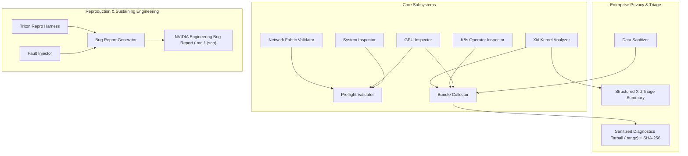

# Architecture Specification: NVAIE Supportability Toolkit

## Architectural Principles

1. **First-Principles Reliability:** Operates independently of complex third-party dependencies using Python standard library primitives wherever possible.
2. **Zero-Trust Enterprise Sanitization:** Guarantees no customer IP addresses, credentials, NGC API tokens, or proprietary organizational identifiers leak into bug reports or diagnostic bundles.
3. **Cross-Platform Diagnostic Portability:** Functions identically across bare-metal DGX SuperPODs, enterprise hypervisors (vSphere / Tanzu), Cloud Service Providers (AWS EKS, Azure AKS, GCP GKE), and Windows test environments.
4. **Actionable Remediation Mapping:** Every failing rule or detected kernel Xid error is directly mapped to concrete operator remediation commands and hardware triage actions.
