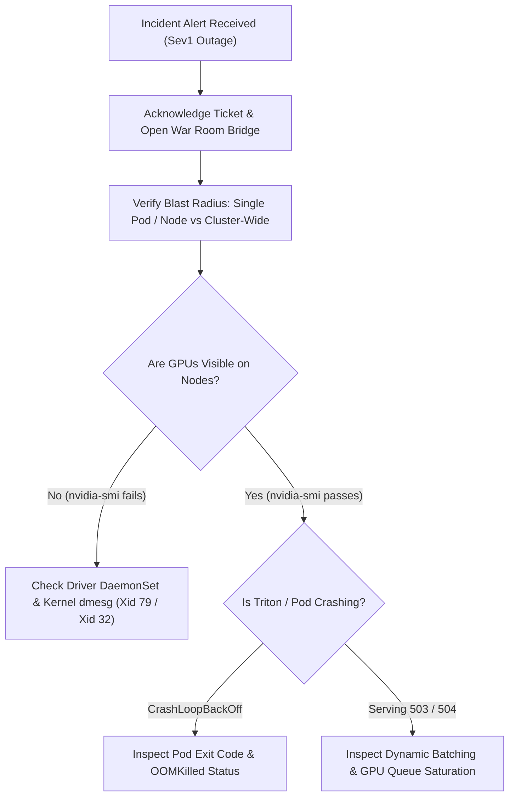

# NVIDIA AI Enterprise (NVAIE) Sev1 Incident Triage Runbook

> **Target Audience:** NVIDIA AI Enterprise Supportability, Escalation, and Sustaining Systems Engineers  
> **SLA:** Initial Customer Response < 15 minutes | Active Mitigation < 45 minutes  
> **Scope:** Sev1 Production Outages on Kubernetes (EKS / GKE / AKS / On-Prem DGX SuperPOD)  

---

## 1. Sev1 Incident Onset Checklist (T+0 to T+15 min)



### Action 1.1: Immediate War Room Bridge Protocol
1. Send standardized Sev1 customer acknowledgment:
   > *"NVIDIA AI Enterprise Escalation Engineering is actively investigating the Sev1 incident on your cluster. Diagnostics collection is underway."*
2. Request sanitized diagnostic bundle using the automated toolkit:
   ```bash
   nvaie-toolkit collect-bundle --sanitize-keyword "<CUSTOMER_NAME>" --output ./triage-artifacts
   ```

---

## 2. Rapid Diagnostic Triage (T+15 to T+30 min)

### Step 2.1: Kernel Ring Buffer & Xid Error Analysis
Run the automated Xid triage engine against kernel `dmesg`:
```bash
nvaie-toolkit triage-xid
```

| Detected Xid | Root Cause Category | Immediate Mitigation |
|:---|:---|:---|
| **Xid 79** | GPU Fallen Off the Bus (PCIe link down / thermal / PSU trip) | **Drain node immediately:** `kubectl drain <node> --ignore-daemonsets --delete-emptydir-data`. Do not attempt hot-reset without warm reboot. Escalate to DC ops for PCIe riser / power supply inspection. |
| **Xid 31** | GPU Memory Page Fault (MMU Illegal Address Read/Write) | Check application tensor bounds. If occurring during dynamic batching, reduce `max_batch_size` in Triton `config.pbtxt` to prevent tensor buffer overruns. |
| **Xid 43** | GPU Engine Timeout (Infinite Loop / CUDA watchdog trip) | Identify stuck PID (`nvidia-smi --query-compute-apps=pid,process_name,used_memory`). Terminate stuck container process; verify watchdog timer limits. |
| **Xid 45** | Compute Preemption Failure (Context switch hung) | Long-running non-cooperative CUDA kernel blocking SMs. Isolate customer model; scale pod replicas to balance load. |
| **Xid 92** | High Uncorrectable ECC Error Rate (HBM/GDDR DRAM failure) | Mark node Unschedulable (`kubectl cordon <node>`). Hardware replacement required (RMA). |

### Step 2.2: Kubernetes GPU Operator Audit
Verify operator DaemonSets and Device Plugin health:
```bash
nvaie-toolkit check-operator --namespace gpu-operator
```
* **Symptom: `nvidia-device-plugin` not ready:** Kubelet cannot advertise `nvidia.com/gpu`. Pods remain in `Pending`.
  * *Fix:* Check if `/var/lib/kubelet/device-plugins/kubelet.sock` is mounted and responsive. Restart Device Plugin pod.
* **Symptom: `nvidia-driver-daemonset` compiling kernel module in loop:**
  * *Fix:* Ensure host has matching Linux kernel headers installed (`linux-headers-$(uname -r)`).

---

## 3. Triton Inference Server Emergency Mitigations (T+30 to T+45 min)

### Mitigation A: Dynamic Batching CUDA OOM Recovery
If Triton pods crash with exit code `137` (OOMKilled) or `139` (SIGSEGV / Xid 31):
1. Patch Triton ConfigMap / `config.pbtxt`:
   ```protobuf
   dynamic_batching {
     max_queue_delay_microseconds: 2000
     # Reduce batch size to prevent activation memory exceeding VRAM
     preferred_batch_size: [ 8, 16 ]
   }
   ```
2. Enable HorizontalPodAutoscaler (HPA) or temporarily increase pod replicas:
   ```bash
   kubectl scale deployment triton-nvaie --replicas=8
   ```

### Mitigation B: Queue Starvation / 504 Gateway Timeout
If clients receive 504 Gateway Timeouts while GPU utilization is low:
* Triton instance groups may be starved on CPU preprocessing threads.
* Increase instance count in `config.pbtxt`:
  ```protobuf
  instance_group [
    {
      count: 2
      kind: KIND_GPU
    }
  ]
  ```

---

## 4. Post-Incident Root Cause Analysis & Engineering Escalation

1. Generate formal NVIDIA Bug Report using the toolkit:
   ```bash
   nvaie-toolkit report-sample --format md --output ./Sev1-Incident-RCA.md
   ```
2. Package reproducible test harness:
   * Provide the customer's input tensor shape and batch config to the reproducible harness:
     ```bash
     nvaie-toolkit repro-triton --url http://<triton-cluster-ip>:8000 --model <model_name> --concurrency 64
     ```
3. Submit RFE / upstream PR to NVIDIA Engineering team with the generated markdown bug report and sanitized `.tar.gz` diagnostic bundle.
